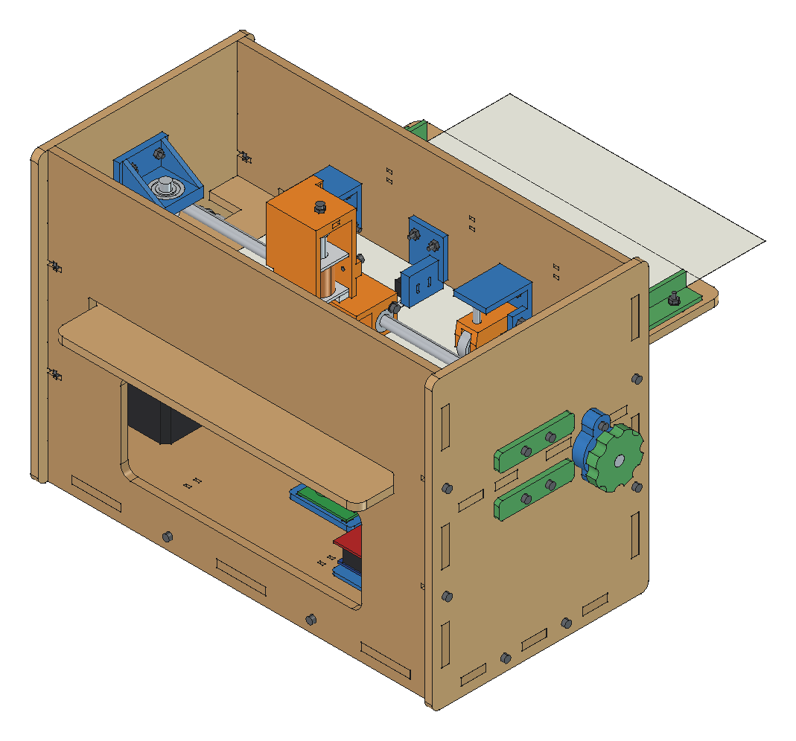
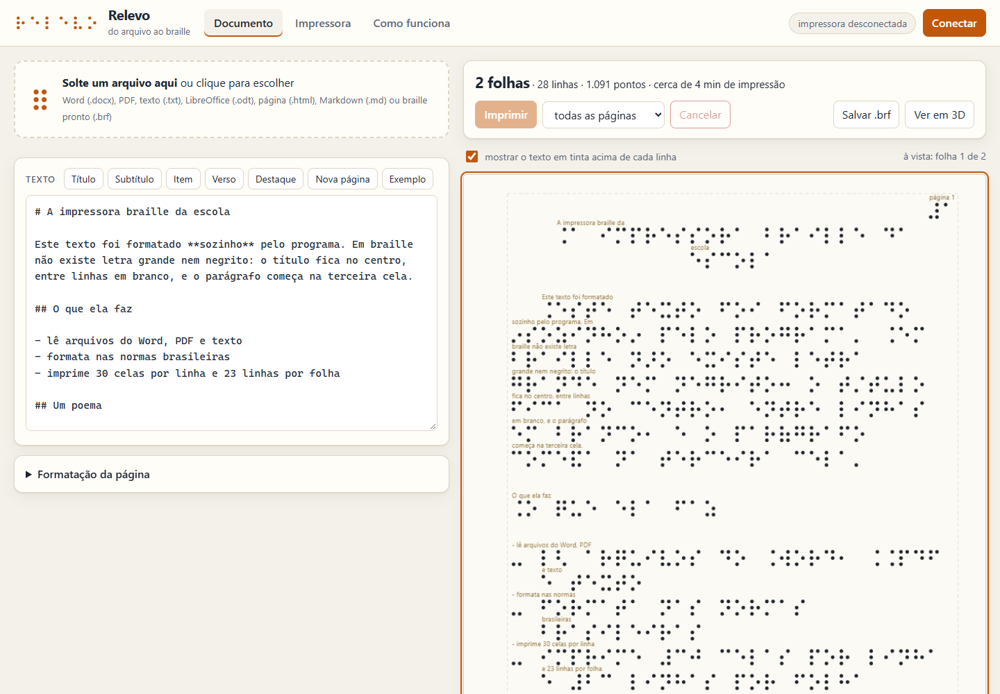
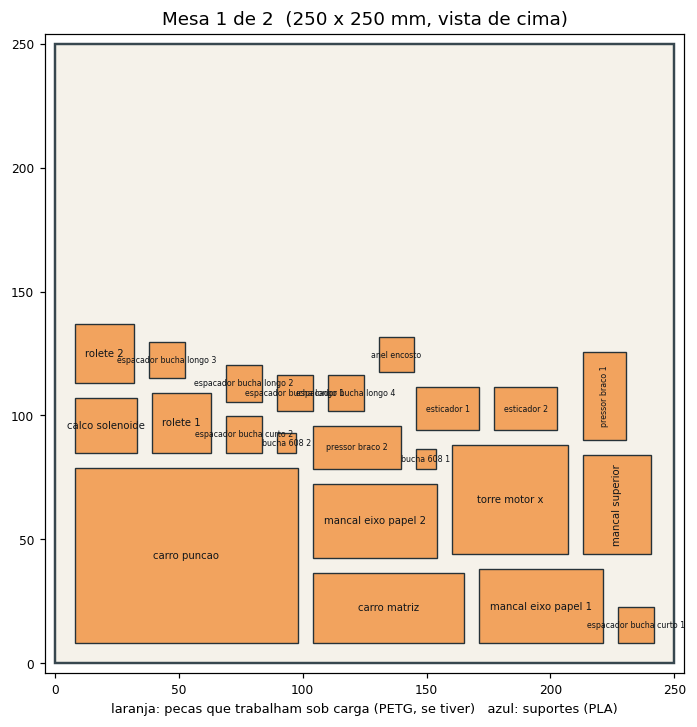

# Impressora braille de baixo custo

Impressora braille para folha A4, feita com MDF de 6 mm cortado a laser, peças impressas em 3D e a eletrônica de uma
impressora 3D comum (Arduino Mega 2560, RAMPS 1.4, dois NEMA 17 e um solenoide). Você solta um arquivo do Word, um
PDF ou um texto no programa e ela devolve a folha em braille, formatada nas normas brasileiras.

**Página do projeto:** <https://murilo999-666.github.io/impressora-braille/>
· **Programa:** [abrir](https://murilo999-666.github.io/impressora-braille/software/)
· **Simulador 3D:** [abrir](https://murilo999-666.github.io/impressora-braille/simulador/)

## Como ela funciona, em quatro frases

1. A folha entra por trás, é puxada por dois roletes de borracha e passa deitada sobre uma mesa.
2. Em cima da folha corre um carro com o solenoide, que **bate de cima para baixo** com um punção de ponta arredondada.
3. Embaixo da folha corre outro carro com a matriz (o furo que dá forma ao ponto). Os dois carros são puxados por
   correias presas ao mesmo eixo vertical, então andam sempre juntos.
4. O ponto sai em relevo na face de baixo. Como a folha entra com o topo na frente, o texto fica na ordem certa: é só
   pegar a folha pela borda da frente e virar.

## O programa

O **Relevo** (`software/index.html`) roda no navegador, sem instalar nada:

- abre Word (.docx), PDF, texto, LibreOffice (.odt), HTML, Markdown e braille pronto (.brf);
- descobre títulos, listas e destaques e formata pelas Normas Técnicas para a Produção de Textos em Braille;
- mostra as folhas antes de imprimir, com o texto em tinta acima de cada linha;
- imprime pelo USB, folha por folha, e salva em .brf.

Manual e regras de formatação: [`docs/11-programa-relevo.md`](docs/11-programa-relevo.md).

## Instalar e usar

1. **Firmware.** Abra `firmware/ImpressoraBraille/ImpressoraBraille.ino` na Arduino IDE, placa Arduino Mega 2560, e
   carregue. Não usa biblioteca.
2. **Programa.** Abra a [página do programa](https://murilo999-666.github.io/impressora-braille/software/) no Edge ou
   no Chrome de um computador. Sem internet: baixe este repositório e abra `software/index.html` com dois cliques.
3. **Conectar.** Cabo USB e fonte de 12 V ligados, botão Conectar, escolha a porta do Arduino.
4. **Imprimir.** Solte o arquivo, confira as folhas, clique em Imprimir.

## Manuais

| Parte | Documento |
|---|---|
| Estrutura: montagem passo a passo | [`docs/06-guia-de-montagem.md`](docs/06-guia-de-montagem.md) |
| Estrutura: como cada conjunto funciona, contas e medidas | [`docs/03-projeto-mecanico.md`](docs/03-projeto-mecanico.md) |
| Elétrica: esquema, ligações, drivers, conferência | [`docs/04-esquema-eletrico.md`](docs/04-esquema-eletrico.md) |
| Software: firmware, comandos e parâmetros | [`docs/07-firmware-e-software.md`](docs/07-firmware-e-software.md) |
| Software: o programa Relevo e a formatação do braille | [`docs/11-programa-relevo.md`](docs/11-programa-relevo.md) |
| Calibração e testes | [`docs/08-calibracao-e-testes.md`](docs/08-calibracao-e-testes.md) |
| Lista de compras | [`docs/05-lista-de-compras.md`](docs/05-lista-de-compras.md) e [`docs/tabelas-geradas.md`](docs/tabelas-geradas.md) |
| Pesquisa sobre o braille | [`docs/01-pesquisa-braille.md`](docs/01-pesquisa-braille.md) |
| Resumo em uma página | [`docs/02-resumo.md`](docs/02-resumo.md) |
| O que está pronto e o que falta | [`docs/09-plano-de-tarefas.md`](docs/09-plano-de-tarefas.md) |

## Arquivos para fabricar

| O quê | Onde |
|---|---|
| Impressão 3D pronta para fatiar: 38 peças em 2 mesas de 250 × 250 mm | `cad/saida/mesas_250x250/` (.3mf e .stl) |
| Impressão 3D, peça por peça (24 modelos, já deitados, sem suporte) | `cad/saida/stl/` |
| Corte a laser do MDF 6 mm: 7 chapas, 3 pranchas de 600 × 400 mm | `cad/saida/corte_laser/` (.dxf e .svg) |
| Modelo 3D completo | `cad/impressora_braille.FCStd` (FreeCAD) e `cad/saida/step/` |
| Esquemas elétricos | `eletrica/` |

## O que tem em cada pasta

| Pasta | Conteúdo |
|---|---|
| `docs/` | Pesquisa, projeto mecânico, esquema elétrico, lista de compras, montagem, calibração, plano de tarefas |
| `cad/` | Modelo 3D paramétrico, gerado por script no FreeCAD. Todas as medidas estão em `cad/parametros.py` |
| `eletrica/` | Esquemas em PNG e SVG e o script que os desenha |
| `firmware/ImpressoraBraille/` | Sketch para a Arduino IDE |
| `software/` | O programa Relevo, o tradutor para braille, o formatador, os importadores e os testes |
| `simulador/` | A máquina em 3D imprimindo o texto que você digitar |
| `index.html` | A página do projeto |

## Números principais

- Tamanho: 330 × 178 × 236 mm, mais a bandeja de entrada (110 mm para trás).
- Folha A4, 30 celas por linha e 23 linhas por folha (máximo mecânico: 33 celas).
- Cela no padrão do papel: 2,5 mm entre pontos, 6 mm entre celas, 10 mm entre linhas.
- Cerca de 8 pontos por segundo. Uma folha cheia de texto leva de 4 a 8 minutos.
- 7 chapas de MDF 6 mm (0,34 m²) e 38 peças impressas (240 g de filamento).

## Estado do projeto

Conferido no computador:

- modelo 3D sem interferência entre peças: 276 peças testadas par a par com os carros na esquerda, no meio, na
  direita, com o punção embaixo e varrendo o curso de 7 em 7 mm (`cad/relatorio_verificacao.txt`);
- todos os STL fechados e orientados para imprimir sem suporte;
- tradutor, formatador e importadores: 100 testes automáticos passando (`node software/testes/teste_braille.js` e
  `node software/testes/teste_formatador.js`);
- firmware compila para o Arduino Mega 2560 sem avisos.

**Ainda não conferido, porque depende da máquina montada:** força real do solenoide, altura do ponto, tração do
papel e tensão das correias. Três peças foram modeladas por foto ou catálogo (solenoide, correia fechada e polias):
meça antes de fabricar, pela tabela de [`docs/03-projeto-mecanico.md`](docs/03-projeto-mecanico.md).

## De onde veio

O projeto parte da BrailleRAP, impressora braille de hardware aberto: tiramos os arquivos dos repositórios públicos
dela e melhoramos o projeto. A eletrônica, os motores e os eixos foram comprados a preço de sucata na Lixotec, em Foz do Iguaçu.
O nosso solenoide é a versão de 24 V do JF-0826B, enquanto a BrailleRAP usa a de 12 V: ligado em 12 V, ele receberia
2,1 W dos 24 W que o projeto original usa. Por isso este projeto dá ao solenoide alimentação própria de 24 a 32 V e
redesenha o resto:

- punção de cima para baixo, com a folha apoiada na mesa na hora da batida;
- os quatro eixos passam pelos mesmos furos das laterais, então o alinhamento sai do corte a laser;
- roletes antes da linha de punção e mesa da frente 1 mm mais baixa;
- caixa parafusada com porca presa;
- firmware próprio e programa no navegador.

## Crédito

A arquitetura de dois carros sincronizados, o uso de RAMPS com dois motores e o truque de usar o sextavado de um
parafuso sem cabeça como matriz vêm da [BrailleRAP](https://github.com/braillerap/BrailleRap) (licença CERN OHL 1.2).
A tabela braille segue a Grafia Braille para a Língua Portuguesa (MEC, 3ª edição, 2018) e foi conferida com a tabela
`pt-pt-g1.utb` do liblouis. A formatação segue as Normas Técnicas para a Produção de Textos em Braille (MEC).
O programa usa [pdf.js](https://mozilla.github.io/pdf.js/) (Apache 2.0) e o simulador usa
[three.js](https://threejs.org/) (MIT); as duas bibliotecas estão copiadas em `software/lib/` e `simulador/lib/`.
