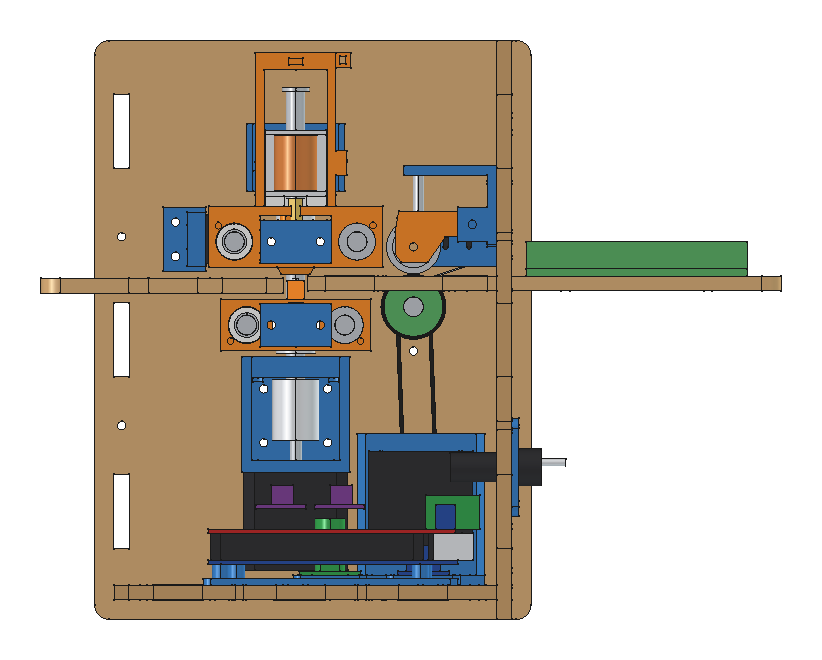
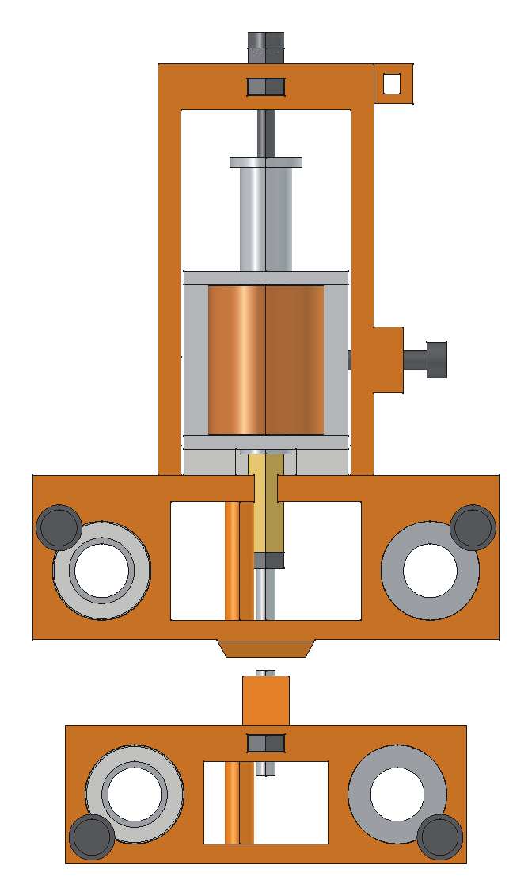

# Projeto mecânico

Todas as medidas saem de um arquivo só, `cad/parametros.py`. O modelo é gerado por script: mudando um número ali e
rodando `cad/rodar.sh gerar`, saem de novo os STL, os DXF e a lista de peças.

Vista do lado direito, sem a lateral. À esquerda da figura fica a frente da máquina; o papel entra pela direita.

## 1. Eixos e sentidos

- **X**: esquerda para direita, é o curso dos carros. x = 0 na face de dentro da lateral esquerda.
- **Y**: frente para trás. y = 0 é a linha de punção. O papel entra por trás (+y) e sai pela frente.
- **Z**: para cima. z = 0 é o piso de dentro da caixa. O papel corre em z = 126 mm.

## 2. Como cada parte funciona

### Carro do punção (de cima)

- Corre em dois eixos de 8 mm (y = ±25 mm, 14 mm acima do papel) com três buchas LM8UU: duas no eixo de trás, uma no da frente.
- O solenoide fica num berço em forma de túnel, apoiado num calço de 4 mm. Dois parafusos M3 na lateral apertam o
  corpo contra a parede oposta. Para subir ou descer o solenoide, troque o calço por um mais grosso ou mais fino.
- No êmbolo vai um espaçador sextavado de latão M3 de 15 mm e, nele, o estilete: um parafuso M3 sem cabeça com a
  ponta afinada para 1,2 mm e arredondada. Uma porca trava a altura.
- No teto do berço, um parafuso M3 faz de batente: ele limita até onde o êmbolo sobe, ou seja, regula o curso (5 mm no projeto).
- Embaixo, um patim de 12 mm de largura passa a 0,8 mm da mesa e segura o papel dos dois lados do punção. As pontas
  são chanfradas para subir na borda da folha sem enroscar. O furo de 7 mm no meio deixa o conjunto do punção
  (espaçador, porca e estilete) entrar por baixo já montado.
- O deck tem um rasgo de lado para a haste do êmbolo: o solenoide entra e sai deslizando, sem desmontar o carro.
- A correia passa por dentro do carro. Cada ponta dá a volta num pino e é presa nela mesma com abraçadeira.

### Carro da matriz (de baixo)

- Mesmo arranjo de buchas, em eixos a y = ±20 mm, 20 mm abaixo do papel.
- Uma torre sobe pela fenda de 10 mm entre as duas mesas. No topo dela vai a matriz: um **parafuso allen sem cabeça
  M3 × 16 com o sextavado para cima**. O furo sextavado de 1,5 mm é a cavidade que dá forma ao ponto. Uma porca M3
  presa num canal impede o parafuso de girar com a vibração. A altura se regula por cima, com a chave allen de 1,5 mm.
- O topo da matriz fica 1,2 mm abaixo da mesa de trás (0,2 mm abaixo da mesa da frente). Assim a matriz passa por
  baixo dos pontos já feitos sem amassar. Na batida o punção desce o papel até ela.

### Sincronismo dos dois carros

Um eixo vertical de 8 mm (o de 103 mm do estoque) fica perto da lateral esquerda, em y = 0. Ele leva duas polias
GT2 de 20 dentes: uma na altura da correia de cima e outra na de baixo. O motor X fica embaixo, ligado ao eixo pelo
acoplamento flexível 5 × 8. Do outro lado, cada correia dá a volta numa polia lisa presa num esticador.

Como as duas polias giram juntas, os carros andam sempre o mesmo tanto. O alinhamento inicial é feito uma vez só,
soltando os parafusos allen da polia de cima (ver o guia de montagem).

### Tração do papel

- O eixo de 366 mm atravessa a máquina 48 mm atrás da linha de punção, por baixo da mesa de trás. Leva dois roletes
  impressos com O-ring de 20 × 3 mm (diâmetro com o O-ring: 26,5 mm), que aparecem 0,7 mm acima da mesa por duas janelas.
- Por cima, dois braços articulados com um rolamento 608 cada apertam o papel contra os O-rings. A força vem de uma
  mola de caneta, apertada num vão de 16 mm. Uma mola de 22 a 25 mm fica com 6 a 9 mm de aperto, que dão de
  2 a 3 N em cada rolete. Se o papel patinar, estique a mola com a mão ou ponha uma arruela de calço.
- O motor Y fica embaixo, num suporte em L, e gira o eixo pela correia fechada de 200 mm (polia de 5 mm no motor,
  polia de 8 mm no eixo, relação 1:1). Os furos do suporte são rasgos de ±4 mm para esticar a correia.
- Na ponta direita do eixo, por fora, um manípulo para mexer o papel com a mão.
- Uma microchave pendurada na parede traseira sente a folha chegando.

Por que os roletes ficam antes do punção: assim nada encosta nos pontos depois de feitos. O preço é que os últimos
48 mm da folha não são impressos, porque quando a borda de trás passa do rolete a folha para de andar. Sobram
297 − 48 − 4 de folga = 245 mm de altura útil, que dão 23 linhas a 10 mm.

### Caixa

- Sete chapas de MDF de 6 mm: duas laterais, frente, trás, base, mesa traseira e mesa frontal.
- As chapas se encaixam por linguetas de 20 a 40 mm em rasgos, e são travadas por 16 parafusos M3 × 16 com porca
  presa num recorte em T. Nada é colado.
- As laterais passam 8 mm para baixo da base. Essa saia serve de pé e protege as cabeças dos parafusos de baixo.
- Os quatro eixos dos carros (330 mm) atravessam as duas laterais e ficam rentes por fora (318 de vão + 2 × 6 de
  MDF = 330). Quatro travas impressas fecham as pontas. Para tirar um eixo, basta soltar uma trava e puxar.
- A mesa de trás sai pela parede traseira e vira a bandeja de entrada (110 mm), com duas guias reguláveis: a da
  esquerda tem ajuste fino de ±5 mm; a da direita corre num rasgo comprido e aceita de A5 (148 mm) a carta (216 mm).
- A mesa da frente fica 1 mm mais baixa, para os pontos (que saem por baixo) não rasparem na borda.
- Na frente há uma janela para ver e alcançar a eletrônica. Atrás, a placa de conectores (entrada de 12 V, chave e fusível) e o furo do cabo USB.

## 3. Contas principais

| Grandeza | Conta | Resultado |
|---|---|---|
| Passos por mm no X | 200 × 16 ÷ (20 × 2) | 80,00 |
| Passos por mm no papel | 200 × 16 ÷ (π × 26,5) | 38,44 |
| Resolução no X | 1 ÷ 80 | 0,0125 mm |
| Curso do carro | de x = 62 a x = 258 | 196 mm |
| Celas por linha (máximo) | (196 − 2,5) ÷ 6 + 1 | 33 |
| Celas por linha (adotado) | margem esquerda 20 mm, direita 13,5 mm | 30 |
| Linhas por folha | (245 − 12 − 5) ÷ 10 + 1 | 23 |
| Tempo para andar 2,5 mm | 2 × √(2,5 ÷ 3000) | 58 ms |
| Tempo por ponto | 58 + 5 + 25 + 30 ms | 118 ms (8,5 pontos/s) |
| Correia de cada carro | 2 × 273 + 40 | 586 mm, corte 650 |
| Distância entre polias da correia fechada | (200 − 40) ÷ 2 | 80 mm |

O carro encosta no fim de curso em x = 62 mm, 8 mm para dentro da borda esquerda da folha (que fica em x = 54 mm).
Por isso a menor margem esquerda possível é 8 mm.

## 4. Medir antes de fabricar

Três peças eu só conheci por foto ou por catálogo. Meça com paquímetro e, se der diferente, mude o número em
`cad/parametros.py` e gere de novo.

| O que medir | Valor usado | Parâmetro | Se estiver diferente |
|---|---|---|---|
| Corpo do solenoide: comprimento (no sentido do êmbolo) × largura × altura | 27 × 25 × 22 mm | `SOL_L`, `SOL_W`, `SOL_H` | muda o berço do carro de cima |
| Ponta do êmbolo: tem rosca M3 macho? | sim | | sem rosca, o espaçador não prende: me avise para desenhar um adaptador |
| Correia fechada: conte os dentes | 100 dentes (200 mm) | `CORREIA_Y_L` | muda a posição do motor Y |
| Polias dentadas: conte os dentes | 20 | `POLIA_DENTES` | muda os passos por mm (parâmetro `ppx` do firmware) |
| Polia lisa: diâmetro da flange e altura | 18 mm e 8,5 mm | `TENS_FLANGE_D`, `TENS_H` | muda o garfo do esticador |
| Microchave: 20 × 6,4 × 10 mm, furos a 9,5 mm | KW11-3Z | `MS_*` | muda os dois suportes |
| Espessura real do MDF | 6,0 mm | `T` | muda todos os encaixes |

Os dois roletes com anel de vedação que vieram com as peças não entram neste projeto: são menores (perto de 22 mm) e deixariam o
eixo a menos de 0,5 mm da mesa. Os novos têm 26,5 mm.

## 5. Corte a laser

- Arquivos em `cad/saida/corte_laser/`: cada chapa em DXF e SVG, mais as pranchas já arrumadas
  (`prancha_600x400_*` em 3 chapas ou `prancha_900x600_*` em 2).
- Traço vermelho é corte. Texto azul (camada GRAVAR) é o nome da peça, para gravar fraco ou ignorar.
- Os desenhos estão na medida nominal, sem compensar a largura do corte (kerf). Os rasgos já têm 0,15 mm de folga na
  largura e 0,2 mm no comprimento.
- **Corte primeiro o `gabarito_teste`.** Ele tem um rasgo e uma lingueta, três furos de 7,9, 8,0 e 8,1 mm e uma
  junta em T. Teste com um eixo de 8 mm e com um parafuso e porca M3:
  - o eixo deve entrar justo, sem folga e sem martelar. Se o furo bom for o de 7,9 ou o de 8,1, ponha esse valor
    em `FURO_EIXO_MDF`;
  - a lingueta deve entrar no rasgo com a mão. Se ficar bamba ou não entrar, ajuste `FOLGA_ENC`.

## 6. Impressão 3D

- 24 modelos, 38 peças, cerca de 240 g. Lista com quantidades em `docs/tabelas-geradas.md`.
- Os STL em `cad/saida/stl/` já estão deitados na posição certa. Nenhum precisa de suporte.
- Para imprimir tudo de uma vez: `cad/saida/mesas_250x250/` tem as 38 peças arrumadas em duas mesas de
  250 × 250 mm (`mesa_1` e `mesa_2`, em .3mf e .stl), com 6 mm entre as peças e 8 mm de borda livre. A mesa 1
  (157 g, 56 mm de altura) junta as peças que trabalham sob carga; a mesa 2 (82 g, 38 mm), os suportes.
- Configuração: camada de 0,2 mm, 3 paredes, 30 % de preenchimento. PLA serve para tudo. Se tiver PETG, use nos dois
  carros e nos braços do pressor, que trabalham sob carga constante.
- A maior peça é a bandeja do Mega (61 × 104 mm). Tudo cabe numa mesa de 180 × 180 mm.
- Furos de parafuso passante têm 3,4 mm. Furos onde o parafuso M3 abre rosca no plástico têm 2,7 mm. Furos das buchas
  LM8UU têm 15,15 mm. Se a sua impressora fecha os furos, passe uma broca.

## 7. Arquivos do modelo

| Arquivo | O que faz |
|---|---|
| `cad/parametros.py` | todas as medidas |
| `cad/impressas.py`, `impressas_fixas.py` | peças impressas |
| `cad/comprados.py` | peças do estoque, simplificadas |
| `cad/maquina.py` | monta tudo, fura as chapas onde cada suporte pede e conta os parafusos |
| `cad/verificar.py` | procura interferência entre peças |
| `cad/gerar.py` | exporta STL, STEP, DXF, SVG, listas e o modelo do simulador |
| `cad/mesas.py` | arruma as peças impressas em mesas de 250 × 250 mm |
| `cad/render.py`, `vistas.py` | salvam o `.FCStd` com cores e as imagens |
| `cad/rodar.sh` | atalhos: `verificar`, `gerar`, `mesas`, `render final` |

Os furos das chapas não são desenhados à mão. Cada suporte impresso declara onde precisa de furo e a chapa é furada
ali. Mover um suporte move o furo junto.
