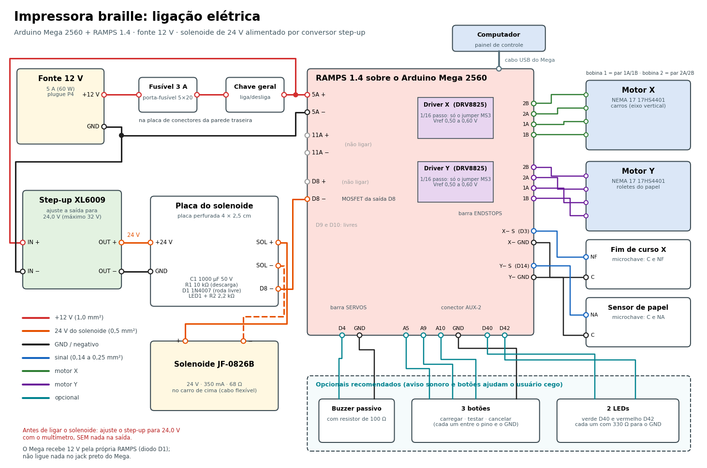
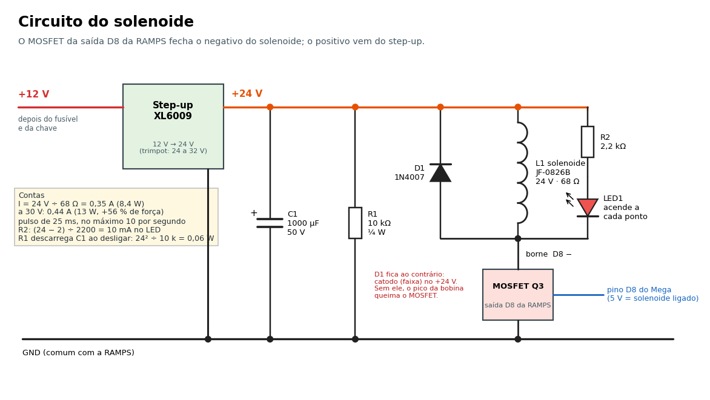

# Esquema elétrico

## 1. Visão geral

Uma fonte de 12 V alimenta tudo. A RAMPS distribui os 12 V para os dois drivers dos motores e, pelo diodo D1 dela,
para o Arduino Mega. O solenoide é de 24 V, então um conversor step-up sobe os 12 V para 24 V só para ele.

| Bloco | Alimentação | Corrente |
|---|---|---|
| Mega + RAMPS (lógica) | 12 V | 0,1 A |
| 2 drivers com os motores a 1,0 A por fase | 12 V | 0,3 a 0,4 A cada |
| Step-up, durante o pulso do solenoide a 24 V | 12 V | 0,8 A (1,4 A se regulado em 32 V) |
| **Total em pico** | | **2,3 A** |

Conta dos motores: cada driver puxa da fonte perto de 2 × I² × R ÷ (V × rendimento) = 2 × 1,0² × 1,5 ÷ (12 × 0,85) = 0,29 A.
Conta do step-up: 24 V × 0,35 A = 8,4 W, dividido por 0,88 de rendimento e por 12 V dá 0,8 A.

Fonte: **12 V, 5 A (60 W)**, com plugue P4 de 5,5 × 2,1 mm. Uma de 3 A funciona, mas sem folga. Fusível de 3 A.

## 2. Por que o solenoide precisa de 24 V

O solenoide de vocês é o JF-0826B na versão **24 V, 350 mA** (está na etiqueta). A resistência da bobina é
24 ÷ 0,35 = 68,6 Ω. A BrailleRAP, de onde saiu o projeto antigo, pede a versão de **12 V, 2 A** do mesmo solenoide.

| Tensão na bobina de vocês | Corrente | Potência | Comparado com a BrailleRAP (24 W) |
|---|---|---|---|
| 12 V (como estava ligado) | 0,17 A | 2,1 W | 9 % |
| 24 V (nominal) | 0,35 A | 8,4 W | 35 % |
| 30 V | 0,44 A | 13,1 W | 55 % |
| 32 V (máximo que recomendo) | 0,47 A | 14,9 W | 62 % |

A força de um solenoide cresce com o quadrado da corrente, ou seja, na mesma proporção da potência. Ligado em 12 V,
o de vocês tinha um décimo da força prevista. Esta é a causa mais provável de o projeto antigo não marcar o papel.

Como o pulso é curto (25 ms) e o firmware nunca deixa o solenoide ligado mais de 40 % do tempo, dá para passar um
pouco da tensão nominal sem esquentar: a 30 V e 8 pontos por segundo, a potência média fica em 13,1 W × 0,2 = 2,6 W,
bem abaixo dos 8,4 W que a bobina aguenta ligada direto em 24 V.

**Plano B:** se mesmo em 32 V o ponto ficar baixo, compre o JF-0826B de 12 V 2 A (mesmo tamanho, encaixa no mesmo
berço). Nesse caso tire o step-up e ligue o positivo do solenoide direto nos 12 V depois do fusível.

## 3. Circuito do solenoide

A saída D8 da RAMPS é um MOSFET que liga o negativo da carga ao GND. Só o borne **D8 −** é usado. O borne D8 + fica
vazio, porque ele é ligado à entrada de 11 A da RAMPS, que neste projeto não recebe nada.

Componentes da placa do solenoide (um pedaço de placa perfurada de 4 × 2,5 cm):

| Ref. | Valor | Para que serve |
|---|---|---|
| C1 | 1000 µF, 50 V, eletrolítico | Reserva de energia para o pulso. O step-up não precisa responder na hora |
| R1 | 10 kΩ, ¼ W | Descarrega C1 em cerca de 30 s quando a máquina é desligada |
| D1 | 1N4007 (ou UF4007) | Diodo de roda livre: absorve o pico da bobina quando o MOSFET abre |
| LED1 + R2 | LED 5 mm + 2,2 kΩ | Pisca a cada ponto. Corrente: (24 − 2) ÷ 2200 = 10 mA |

Cuidados:

- **D1 fica ao contrário da corrente normal:** a faixa (catodo) vai no +24 V. Sem ele, o pico da bobina queima o MOSFET da RAMPS, que não tem esse diodo.
- C1 tem polaridade: a faixa com o sinal de menos vai no GND. Use 50 V para poder regular até 32 V.
- LED1: perna comprida (anodo) do lado do resistor, que vai no +24 V. Perna curta no SOL −.
- O cabo que vai até o solenoide se mexe com o carro. Use fio flexível de 0,5 mm², deixe uma barriga de uns 18 cm
  por cima e prenda as duas pontas com abraçadeira: uma no olhal do carro, outra na parede traseira.

### Regular o step-up (faça antes de ligar o solenoide)

1. Ligue só a entrada do XL6009 nos 12 V. Nada na saída.
2. Multímetro em tensão contínua na saída. Gire o trimpot até marcar **24,0 V**. São muitas voltas; se a tensão
   descer em vez de subir, gire para o outro lado.
3. Desligue, espere o LED da placa do solenoide apagar e só então ligue o resto.

## 4. Ligações da RAMPS

| Função | Onde na RAMPS | Pino do Mega | Fio |
|---|---|---|---|
| Entrada 12 V | borne verde, par **5A** (+ e −) | | 1,0 mm² vermelho e preto |
| Entrada 11A | não ligar | | |
| Motor X (carros) | soquete X, barra de 4 pinos 2B 2A 1A 1B | passo D54, direção D55, liga D38 | cabo do motor |
| Motor Y (papel) | soquete Y, barra de 4 pinos | passo D60, direção D61, liga D56 | cabo do motor |
| Fim de curso do X | barra ENDSTOPS, posição X− (pinos S e −) | D3 | 2 × 0,14 mm² |
| Sensor de papel | barra ENDSTOPS, posição Y− (pinos S e −) | D14 | 2 × 0,14 mm² |
| Solenoide | borne azul **D8 −** | D8 | 0,5 mm² |
| Buzzer (opcional) | barra SERVOS, pino D4 e GND | D4 | com resistor de 100 Ω em série |
| Botão carregar (opcional) | AUX-2, A5 e GND | D59 | |
| Botão teste (opcional) | AUX-2, A9 e GND | D63 | |
| Botão cancelar (opcional) | AUX-2, A10 e GND | D64 | |
| LED verde (opcional) | AUX-2, D40, com 330 Ω para o GND | D40 | |
| LED vermelho (opcional) | AUX-2, D42, com 330 Ω para o GND | D42 | |

Os números dos pinos são os do arquivo `firmware/ImpressoraBraille/config.h`. Se mudar um, mude o outro.

**Como achar o par 5A no borne verde:** a serigrafia da RAMPS mostra "5A" e "11A" ao lado dos dois fusíveis
amarelos. O fusível menor é o de 5 A e o par de bornes ao lado dele é o que se usa. Confira com o multímetro em
continuidade: o borne + do par 5A dá continuidade com um lado do fusível pequeno.

**Não ligue nada no jack preto do Mega.** Ele recebe os 12 V pela RAMPS. O cabo USB pode ficar ligado junto.

### Microchaves

Cada microchave tem três terminais: C (comum), NA (normalmente aberto) e NF (normalmente fechado).

- **Fim de curso do X: C e NF.** Parada, a chave fica fechada. Se um fio soltar, o firmware entende como "apertada" e
  o carro para, em vez de bater na lateral.
- **Sensor de papel: C e NA.** Sem papel fica aberta. Se um fio soltar, o firmware entende "sem papel" e não imprime no ar.

Nos dois casos, C vai no pino − (GND) e o outro terminal no pino S. O pino + da barra não é usado.

## 5. Motores e drivers

### Qual driver vocês têm

Pelas fotos são **DRV8825**: placa roxa, com o CI retangular e terminais dos dois lados. O A4988 costuma vir em
placa vermelha ou verde, com um CI quadrado pequeno sem terminais aparentes. Para ter certeza, puxe um driver e leia
a serigrafia do lado de baixo, ou tire o dissipador e leia o CI.

| | DRV8825 | A4988 |
|---|---|---|
| Jumpers para 1/16 de passo | **só MS3** (o da ponta) | os três |
| Com os três jumpers | 1/32 de passo: o carro andaria metade | 1/16 |
| Corrente pela tensão no trimpot (Vref) | I = Vref × 2 | I = Vref ÷ 0,8 (resistores R100) |
| Vref para 1,0 A | **0,50 V** | 0,80 V |
| Posição no soquete | trimpot para o lado dos bornes de potência | trimpot para o lado oposto |

O firmware espera 1/16 de passo: 200 × 16 ÷ (20 dentes × 2 mm) = **80 passos por mm** no X.

### Ajuste da corrente (Vref)

O 17HS4401 aguenta 1,7 A por fase, mas aqui 1,0 a 1,2 A sobram. Os dois carros somam uns 350 g; para acelerar a
3 m/s² a correia faz 0,35 × 3 = 1,05 N. Com 1,0 A o motor segura perto de 0,25 N·m, que na polia de 6,4 mm de raio
dá 39 N.

1. Fonte ligada, motores **desconectados** do soquete (nunca tire ou ponha motor com a fonte ligada: queima o driver).
2. Multímetro em tensão contínua: ponta preta no GND (borne 5A −), ponta vermelha no metal do trimpot.
3. Gire devagar até **0,50 V** (DRV8825). Faça nos dois drivers.
4. Desligue, conecte os motores, ligue.

### Cabo do motor

O 17HS4401 tem duas bobinas. Na barra da RAMPS, uma bobina ocupa os pinos 1A e 1B e a outra os pinos 2A e 2B.
Para achar os pares sem esquema: encoste dois fios do motor um no outro e gire o eixo com a mão. Se ficar mais duro
de girar, os dois são da mesma bobina. Se o motor girar para o lado errado, não precisa mexer no fio: mande
`$S invx=1` (ou `invy=1`) e depois `$W`.

## 6. Conferência antes de ligar pela primeira vez

1. Com a fonte desligada, meça a resistência entre + e − do borne 5A: não pode dar curto (perto de 0 Ω).
2. Drivers encaixados no sentido certo e só o jumper MS3 em cada soquete.
3. Diodo D1 da placa do solenoide com a faixa no +24 V. Capacitor com o menos no GND.
4. Step-up já regulado em 24,0 V.
5. Solenoide ligado em SOL + e SOL −. Nada no borne D8 +.
6. Ligue. O LED "ON" do Mega acende e o buzzer, se instalado, toca duas notas. Abra o painel e mande `$I`: a resposta mostra o
   estado do fim de curso e do sensor. Aperte cada chave com o dedo e mande `$I` de novo para ver mudar.
7. Mande `$P 1`. O solenoide dá uma batida e o LED1 pisca. Se o LED1 ficar aceso direto, desligue na hora: o MOSFET
   está em curto ou o fio foi para o borne errado.

## 7. Lista de componentes eletrônicos

| Qtd | Item | Observação |
|---:|---|---|
| 1 | Fonte chaveada 12 V 5 A, plugue P4 5,5 × 2,1 mm | |
| 1 | Módulo step-up XL6009 regulável | entrada 12 V, saída até 35 V |
| 1 | Capacitor eletrolítico 1000 µF 50 V | |
| 1 | Diodo 1N4007 | ou UF4007 |
| 1 | Resistor 10 kΩ ¼ W | |
| 1 | Resistor 2,2 kΩ ¼ W | |
| 1 | LED 5 mm | qualquer cor |
| 1 | Placa perfurada 4 × 2,5 cm (ou maior, cortada) | |
| 3 | Borne KRE de 2 vias (opcional) | para soltar os fios sem solda |
| 1 | Jack P4 fêmea de painel 5,5 × 2,1 mm | rosca M8 |
| 1 | Chave alavanca 2 posições, rosca 6 mm | |
| 1 | Porta-fusível de painel 5 × 20 mm + fusíveis de 3 A | compre 3 fusíveis |
| 1 | Microchave KW11-3Z com haste | sensor de papel (a do fim de curso vocês já têm) |
| 1 m | Cabo paralelo flexível 2 × 0,5 mm² | solenoide |
| 1 m | Cabo 2 × 1,0 mm² | 12 V |
| | Fios finos, terminais ou conectores Dupont, termorretrátil, abraçadeiras de 2,5 mm | |
| 1 | Cabo USB A para B | Mega |

Opcionais: 1 buzzer passivo de 5 V e 1 resistor de 100 Ω; 3 botões táteis de 12 mm; 1 LED verde, 1 vermelho e 2 resistores de 330 Ω.

Os esquemas são desenhados por `eletrica/gerar_esquema.py`. Para mudar algo, edite o script e rode de novo.
